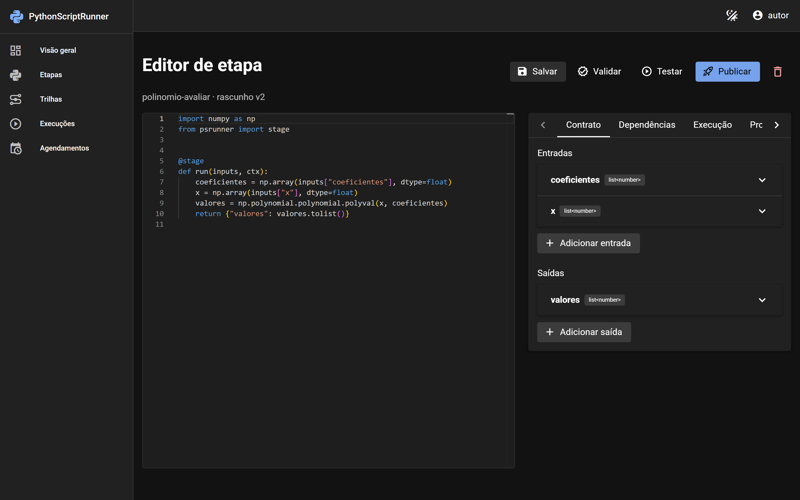
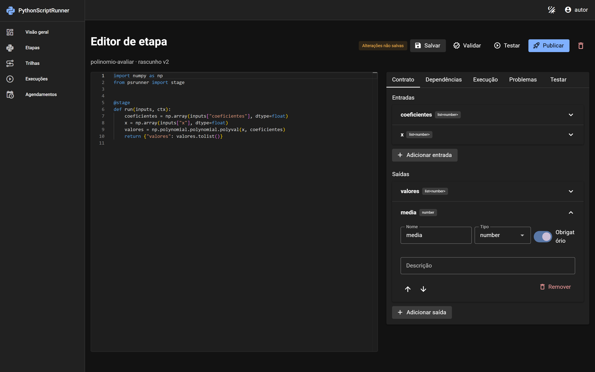
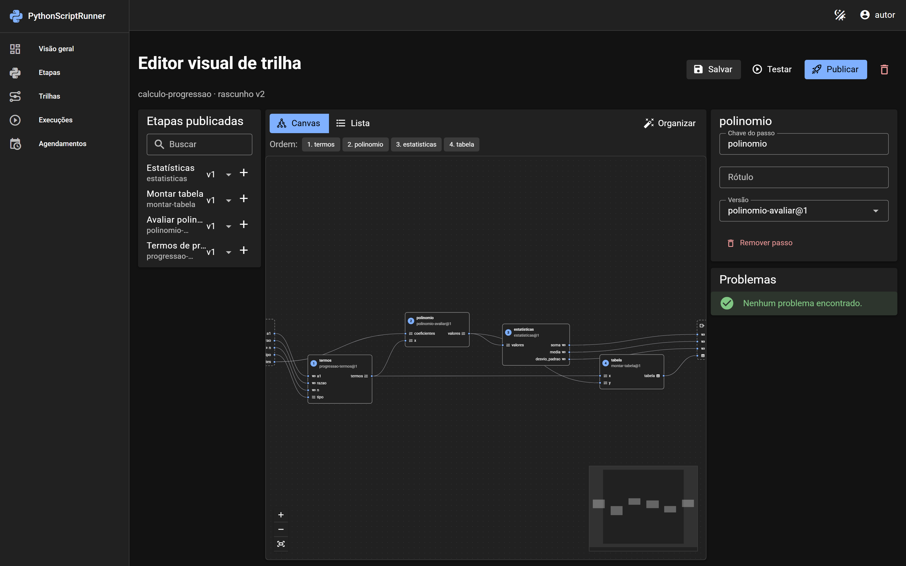
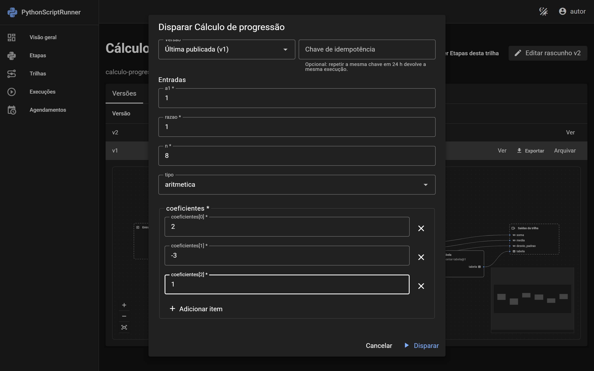
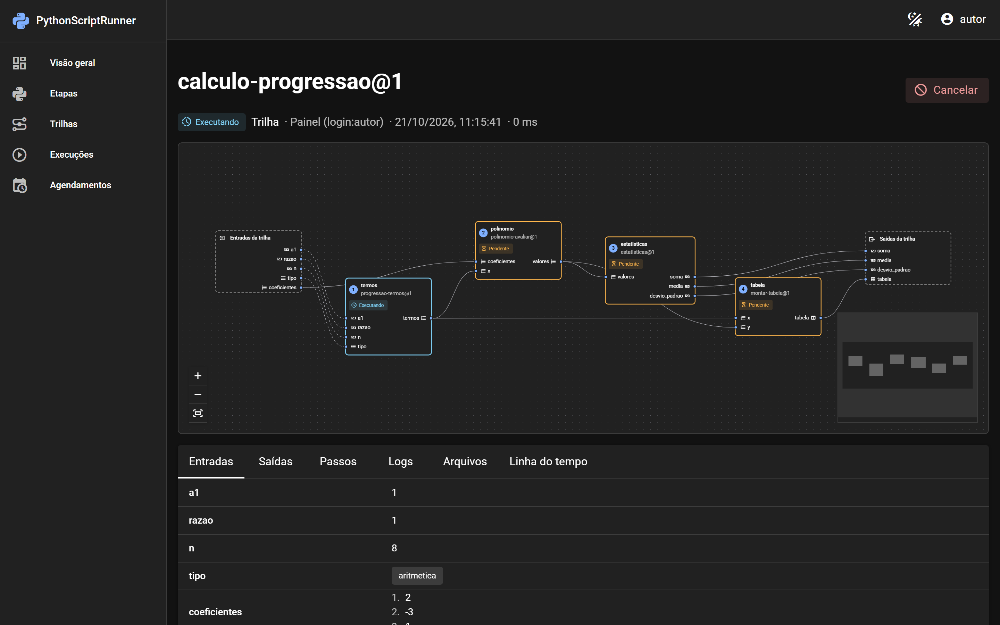
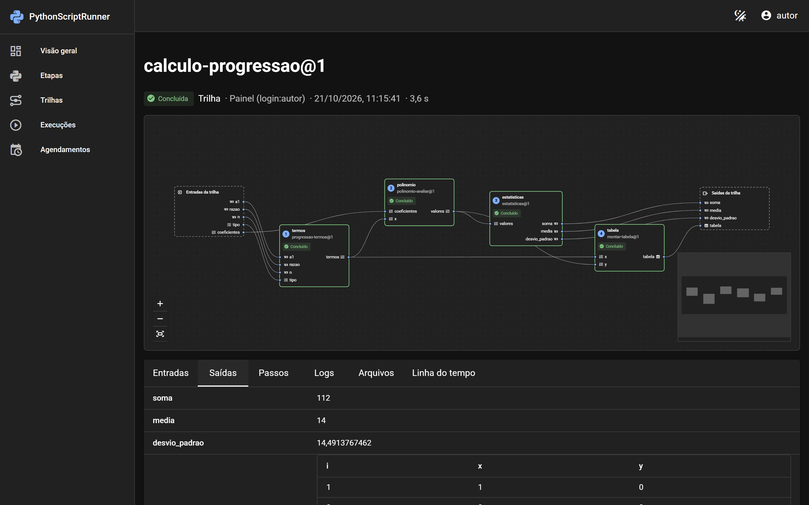

# Dashboard

English | [Português](../pt-br/dashboard.md)

`PythonScriptRunner.Dashboard` embeds a web UI in your ASP.NET Core application, in the style of Hangfire. It has an
internal API, real-time updates over SignalR and a Vue interface, all inside the package: there is nothing to host
separately. The dashboard needs [persistence](persistence.md) and the [queue](queue-and-worker.md), because it stores
versions and history and runs tests and runs on the workers.

## Setup

```bash
dotnet add package PythonScriptRunner.Dashboard
```

```csharp
builder.Services
    .AddPythonScriptRunner()
    .AddEntityFrameworkCore(o => o.UseNpgsql(builder.Configuration.GetConnectionString("psr")!))
    .AddRabbitMq(o => o.ConnectionString = builder.Configuration.GetConnectionString("rabbitmq"))
    .AddDashboard(o => o.UseFixedLogin(login => login.BindConfiguration()));   // section PythonScriptRunner:Dashboard:Login

var app = builder.Build();
app.MapPythonScriptRunnerDashboard("/psr");
```

`MapPythonScriptRunnerDashboard("/psr")` serves:
- the UI at `/psr/`;
- the API at `/psr/api`;
- real-time updates at `/psr/hubs/runs`.

Without that call there is no dashboard. To run it somewhere other than your own application, use the ready-made
`DashboardHost` image (see [Hosting](hosting.md)).

## What you can do

The UI is in Brazilian Portuguese, with light and dark themes. An English version is planned.

**Edit a stage.** Write the script in a Monaco editor and build the contract with a field builder: name, type, required,
default value and description. The Dependencies tab sets the Python version and the requirements. You can test a draft
on a real worker before publishing it.





**Build a pipeline.** Drag published stages onto a canvas and connect outputs to inputs. The handles are typed, and
problems are listed while you edit. A list view offers the same editing without the canvas.



**Run and follow.** Start a run from a form generated from the contract. The flow shows each step changing status live.
The tabs show the inputs, the outputs (tables included), the logs of every attempt, the files and a timeline. Failed runs
can be retried from the step that failed, and running ones can be cancelled.







The UI also has:
- an overview of the last 24 hours;
- run lists with filters;
- cron schedules, with a preview of the next occurrences;
- the audit log;
- an administration page for the `Admin` role.

## Access modes

Choose **one** main mode:

| Mode | Configuration | When to use |
|------|---------------|-------------|
| Fixed login | `o.UseFixedLogin(l => l.BindConfiguration())`, or `l.Users` in code | A few known users, no identity provider. |
| Host authentication | `o.UseHostAuthentication(r => { ... })` | Your application already authenticates users (cookies, OpenID Connect, Microsoft Entra ID). |
| Custom filter | `o.UseAuthorizationFilter<MyFilter>()` | Your own rule: an `IDashboardAuthorizationFilter` returns `DashboardUser(name, role)` or `null`. |
| Local requests | `o.AllowLocalRequests = true` | Development only (startup fails outside Development). It adds to a main mode. |

## Roles

The four roles are cumulative:

| Role | Can |
|------|-----|
| `Reader` | See everything: catalog, runs, logs, files, schedules. |
| `Executor` | Also start, cancel and retry runs. |
| `Author` | Also edit, test, publish, import and schedule. |
| `Admin` | Also delete, and manage retention, secrets status and the audit log. |

## Fixed login

Users live in configuration. The password is never stored, only its hash (PBKDF2, the ASP.NET Identity format):

```json
"PythonScriptRunner": {
  "Dashboard": {
    "Login": {
      "Users": [
        { "Name": "ana", "Role": "Admin", "PasswordHash": "AQAAAAIAAYagAAAAE..." },
        { "Name": "bruno", "Role": "Reader", "PasswordHash": "AQAAAAIAAYagAAAAE..." }
      ]
    }
  }
}
```

Generate the hash with the `psr` tool:

```bash
dotnet tool install -g PythonScriptRunner.Tool
psr hash-password                              # asks for the password twice, without echo
echo "password" | psr hash-password --stdin    # for scripts
```

How fixed login behaves:
- **Session:** an HttpOnly `psr.session` cookie (`SameSite=Lax`), sliding for 8 hours, 24 hours at most.
- **Lockout:** 5 failed attempts in a row lock the user for 15 minutes, and one IP can try 10 times per minute.
- **Configuration changes:** they apply without a restart. A removed user or a changed password ends the session, and a
  new role applies at once.
- **Cookie keys:** they are stored in the database (`psr.dashboard_keys`), so a session works on every instance and
  survives restarts.

## Host authentication

Map each role to an authorization policy of your application, and tell the dashboard where your login page is:

```csharp
.AddDashboard(o => o.UseHostAuthentication(r =>
{
    r.Reader = p => p.RequireRole("psr-reader");
    r.Executor = p => p.RequireRole("psr-executor");
    r.Author = p => p.RequireRole("psr-author");
    r.Admin = p => p.RequireRole("psr-admin");
    r.LoginUrl = "/account/login?returnUrl={returnUrl}";
}));
```

## The API

The API is internal: it exists for the UI and can change between versions. To integrate other systems, use the .NET
library or the [RabbitMQ command and events](queue-and-worker.md#systems-written-in-other-languages).
- **Writes:** requests that change something require the header `X-PSR-Request: 1`.
- **Edits:** they use `ETag` and `If-Match`.
- **Errors:** they follow `ProblemDetails` with a `code`.

In Development, the OpenAPI document is at `/psr/api/openapi/v1.json`.
